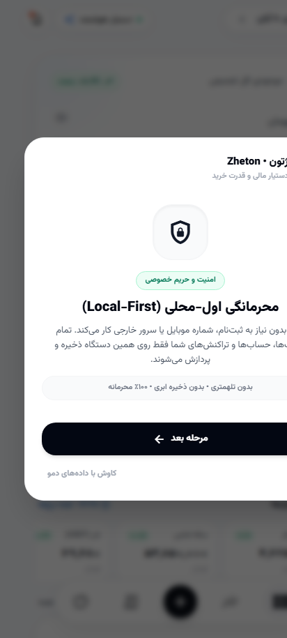
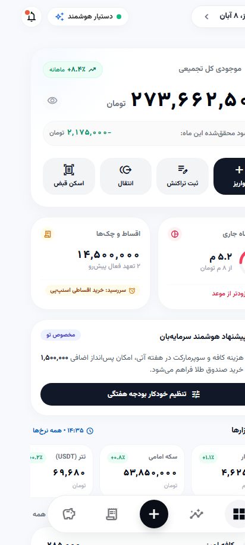
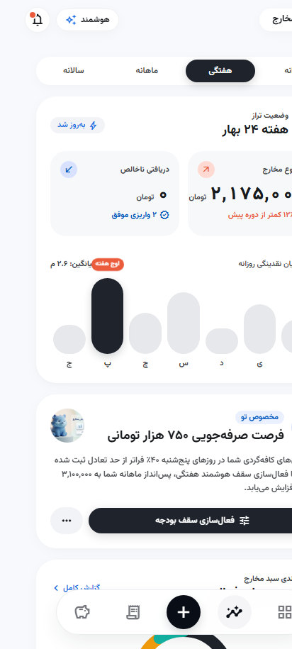
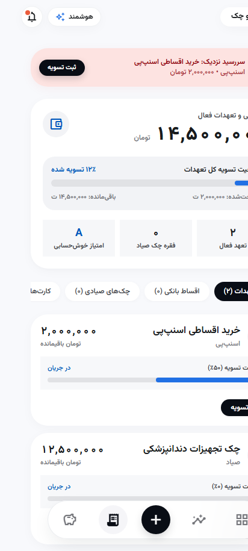
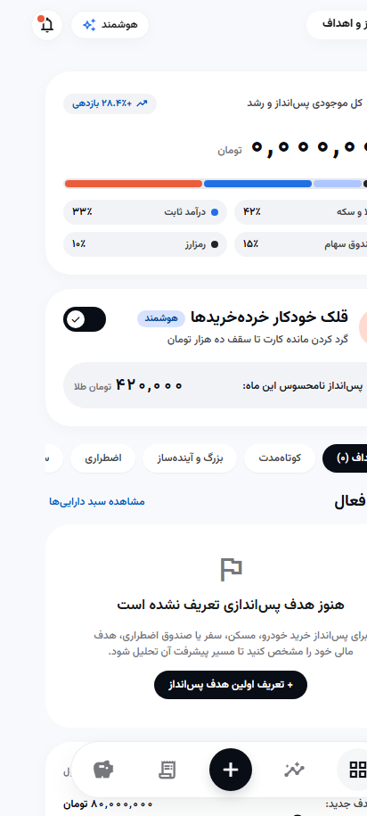
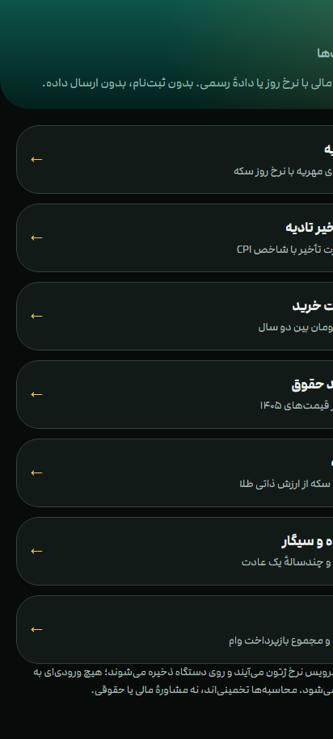
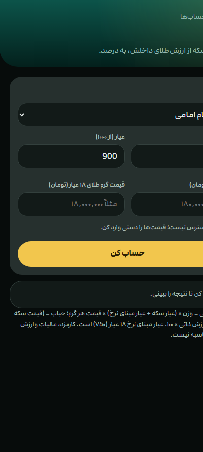

# ژتون (Zheton) — دستیار هوشمند مالی و دیده‌بان قدرت خرید

<div dir="rtl">

**ژتون (Zheton)** یک دستیار مالی شخصی و خانوادگی، دیده‌بان بلادرنگ قدرت خرید و جعبه‌ابزار محاسبات اقتصادی ویژه کاربران ایرانی است. این نرم‌افزار با معماری **اول-محلی (Local-First)**، کاملاً آفلاین و با اولویت مطلق بر حریم خصوصی و امنیت داده‌ها طراحی شده است؛ بدون نیاز به شماره موبایل، بدون ارسال داده به سرور و بدون ره‌گیری تبلیغاتی.

</div>

<p align="center">
  <a href="https://github.com/PouyaRN/Zheton/actions/workflows/check.yml"></a>
  <a href="https://github.com/PouyaRN/Zheton/actions/workflows/release.yml"></a>
  <a href="https://github.com/PouyaRN/Zheton/releases/latest"></a>
  
  <a href="LICENSE"></a>
</p>

---

## 📱 نمای اپلیکیشن ژتون (Screenshots)

<p align="center">
  
  
  
  
  
  
</p>

<p align="center">
  <sub>از راست به چپ: ماشین‌حساب‌های مالی، پس‌انداز و اهداف، اقساط و چک‌های صیادی، تحلیل مخارج، داشبورد نئوبانک و صفحه خوش‌آمدگویی استارتر.</sub>
</p>

---

<div dir="rtl">

## 🌟 قابلیت‌های کلیدی ژتون

### ۱. سیستم دیزاین نوین Lithe Vitality و تجربه کاربری تمیز
- **جریان آنبوردینگ استارتر (Starter Onboarding Flow):** معرفی سه‌مرحله‌ای فلسفه محرمانگی، سپر تورمی و مدیریت خودکار تعهدات با شروع کاملاً پاک و بدون هرگونه داده ساختگی، تست یا ماک.
- **تایپوگرافی اصیل فارسی و قالب اعداد طبیعی:** نمایش مبالغ به شیوه رایج گفتاری ایرانیان (مانند «۴٫۷ میلیارد تومان») همراه با قطع اعداد اعشاری به جای گرد کردن جهت شفافیت صددرصدی مالی.

### ۲. داشبورد و مرکز فرمان مالی (Command Center & Cockpit)
- **نمایشگر مرکزی دارایی (Hero Display):** پایش همزمان ارزش کل دارایی، تراز نقدینگی و معادل گرم طلای ۱۸ عیار.
- **موتور خرج امن روزانه (`SafeSpendEngine`):** محاسبه هوشمند سقف خرج مجاز امروز با اعمال ضریب استراحت و افزایش مخارج پنج‌شنبه و جمعه در ایران و کسر تعهدات جاری.
- **دیده‌بان خونریزی تورمی نقدینگی:** محاسبه افت روزانه ارزش ریال راکد بر اساس نرخ رسمی تورم کشور.
- **تابلوی زنده مظنه بازار:** رصد لحظه‌ای نرخ طلای ۱۸ عیار، مثقال، نقره، سکه امامی، بهار آزادی، نیم‌سکه، ربع‌سکه، تتر (USDT)، دلار، یورو، درهم و صندوق‌های طلای بورس با نمودارهای خطی (`Sparkline`).

### ۳. خوانش هوشمند و امن پیامک‌های بانکی (`SmsParser`)
- استخراج خودکار مبلغ، جهت تراکنش (واریز/برداشت)، مانده حساب و نام بانک از پیامک‌های بانکی کشور به صورت کاملاً آفلاین روی حافظه دستگاه.
- نگهداری تصحیحات کاربر، یادداشت‌ها و برچسب‌های ضرورت تراکنش.

### ۴. دسته کارت‌های بانکی شتاب و مدیریت اقساط
- **کارت‌های تعاملی شتاب:** پشتیبانی کامل از پیش‌شماره‌های شبکه شتاب بانکی کشور، اعتبارسنجی الگوریتم `Luhn` و ساختار شبا (`ISO-7064`)، همراه با کپی تک‌لمسی شماره کارت و شبا.
- **رهگیری اقساط و چک صیادی:** ثبت و پایش اقساط سرویس‌های `BNPL` (اسنپ‌پی، دیجی‌پی، تارا)، وام‌های بانکی و موعد چک‌های صیادی همراه با یادآور هوشمند روز سررسید.

### ۵. تحلیل ۵۰/۳۰/۲۰ و دسته‌بندی هوشمند مخارج
- تفکیک خودکار و دستی مخارج به ۳ گروه: نیازهای اساسی (۵۰٪)، خواسته‌ها (۳۰٪) و پس‌انداز/سرمایه‌گذاری (۲۰٪).
- پایش سقف بودجه تعیین‌شده در هر سرفصل و هشدارهای صرفه‌جویی هفتگی.

### ۶. قلک خودکار خرده‌خریدها و اهداف پس‌انداز
- قابلیت گرد کردن خودکار مانده تراکنش‌ها به بالا (سقف ۱۰ هزار تومان) و پس‌انداز نامحسوس روزانه در صندوق طلا.
- تعیین اهداف مالی کوتاه‌مدت، اضطراری و میان‌مدت با شبیه‌ساز پیشرفت بازدهی.

### ۷. هفت ماشین‌حساب تخصصی اقتصاد ایران
۱. **حباب‌سنج سکه:** محاسبه ارزش ذاتی طلای انواع قطعات سکه و استخراج درصد حباب اسمی.  
۲. **اقساط وام بانکی:** محاسبه فرمول `PMT`، مجموع بازپرداخت و سود کل بر اساس سودهای رایج بانکی ایران.  
۳. **تورم و قدرت خرید تومان:** محاسبه افت ارزش ریال در طول زمان بر اساس شاخص رسمی `CPI` بانک مرکزی از سال ۱۳۸۰ تا ۱۴۰۵.  
۴. **ارزش روز مهریه:** فرمول رسمی قوه قضائیه به نرخ روز و معادل‌سازی بر حسب گرم طلای ۱۸ عیار.  
۵. **خسارت تأخیر تادیه:** محاسبه جریمه دیرکرد قانونی بر اساس شاخص سالانه/ماهانه بانک مرکزی و ماده ۵۲۲ آیین دادرسی مدنی.  
۶. **سنجش قدرت خرید حقوق:** مقایسه درآمد سال‌های پیشین با سبد معیشت واقعی و تورم انباشته.  
۷. **هزینهٔ عادت‌های روزانه:** محاسبه اثر مرکب خریدهای کوچک مکرر (کافه، دخانیات و...) با اعمال نرخ تورم انتظاری.

<p align="center">
  
</p>

---

### 🏦 بانک‌های تحت پوشش
بلو بانک (`Blu`)، سامان، رفاه، پاسارگاد، اقتصاد نوین، خاورمیانه، صادرات، رسالت، پارسیان، ملت، ملی، مسکن، سپه، تجارت، شهر و تمامی بانک‌های عضو شبکه شتاب.

</div>

---

<div dir="rtl">

## 📥 دانلود و نصب اپلیکیشن

نسخه رسمی، کامپایل‌شده و امضاشده (`Signed APK`) را می‌توانید مستقیماً از بخش انتشار گیت‌هاب دریافت نمایید:

- **[دانلود مستقیم zheton-v1.1.1.apk](https://github.com/PouyaRN/Zheton/releases/download/v1.1.1/zheton-v1.1.1.apk)** (حجم: ۱۳.۵ مگابایت)
- **پیش‌نیاز:** اندروید نسخه ۷.۰ (`API 24`) به بالا

</div>

---

<div dir="rtl">

## 🛠️ ساخت و کامپایل از سورس (Build from Source)

پیش‌نیازها: `JDK 21`، `Node.js 20+` و `Android SDK (API 36)`.

</div>

```bash
# دریافت مخزن
git clone https://github.com/PouyaRN/Zheton.git
cd Zheton

# ۱. اجرای تست‌های واحد و کامپایل نسخه اندروید
./gradlew testDebugUnitTest
./gradlew assembleRelease
# خروجی در app/build/outputs/apk/release/app-release.apk

# ۲. اجرای وب‌اپلیکیشن و ماشین‌حساب‌ها (PWA)
cd pwa
npm install
npm run dev
```

---

<div dir="rtl">

## 📂 معماری ماژولار پروژه

</div>

```text
Zheton/
├── app/       # اپلیکیشن نیتیو اندروید (Kotlin, Jetpack Compose, Room DB, KSP, Coroutines)
├── pwa/       # وب‌اپلیکیشن همراه و ماشین‌حساب‌های مالی (React 18, Vite, TypeScript, Tailwind CSS)
├── sync/      # سرویس رمزنگاری‌شده گاوصندوق خانواده (Cloudflare Worker + Durable Objects)
├── worker/    # سرور استعلام بلادرنگ نرخ طلا، ارز و بورس تهران (Cloudflare Worker)
└── docs/      # اسناد معماری، دیزاین سیستم Lithe و اسکرین‌شات‌ها
```

---

<div dir="rtl">

## 🛡️ امنیت و محرمانگی داده‌ها (Privacy by Design)

- **بدون ذخیره ابری اطلاعات شخصی:** کلیه پیامک‌ها، تراکنش‌ها، کارت‌های بانکی و ترازهای مالی منحصراً روی حافظه رمزنگاری‌شده دستگاه کاربر ذخیره می‌شوند.
- **پردازش درون‌دستگاهی پیامک:** مجوز `READ_SMS` تنها جهت استخراج محلی مبالغ بانکی استفاده شده و متن هیچ پیامکی به اینترنت ارسال نمی‌شود.
- **رمزنگاری سرتاسری (`E2EE`):** همگام‌سازی اختیاری خانوادگی با کلید متقارن `AES-GCM` روی دستگاه رمزگذاری می‌شود و سرور به داده‌های خام مالی دسترسی ندارد.
- **بدون ترکر، تبلیغات یا تله‌متری (`Telemetry`):** کد پروژه کاملاً متن‌باز و تحت مجوز MIT منتشر شده است.

</div>

---

<div dir="rtl">

## 📄 مجوز (License)

توسعه‌یافته تحت مجوز آزاد [MIT](LICENSE).

</div>
