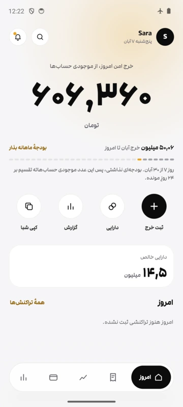
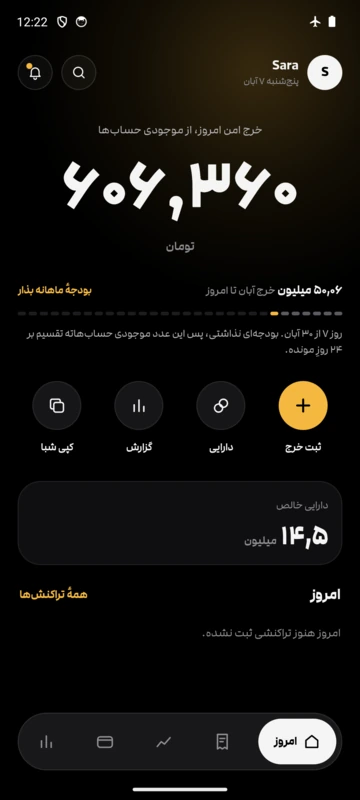
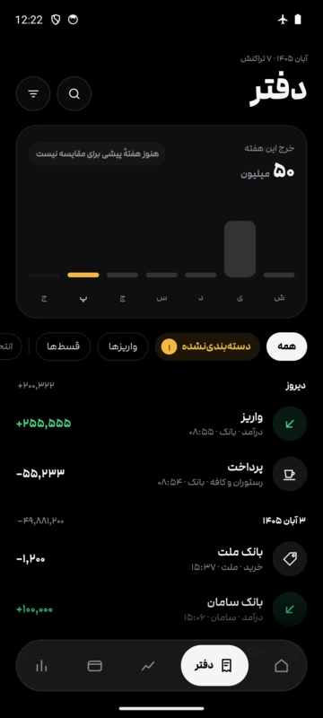
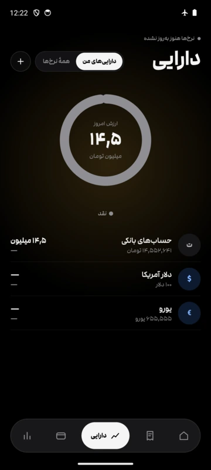
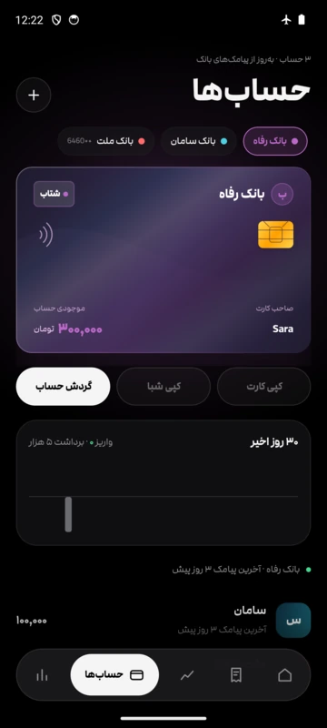
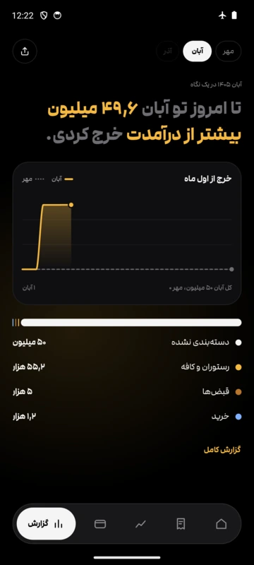

# ژتون — Zheton

دستیار مالی شخصی، دیده‌بان قدرت خرید بلادرنگ و جعبه‌ابزار محاسبات اقتصادی برای کاربران ایرانی: دفتر کل هوشمند مبتنی بر پیامک‌های بانکی، رصد سبد دارایی‌ها به نرخ آزاد تهران و بودجه‌بندی هوشمند به تومان.

[](https://github.com/securityvisions/Andis/actions/workflows/check.yml)
[](https://github.com/securityvisions/Andis/actions/workflows/release.yml)
[](https://github.com/securityvisions/Andis/releases/latest)
-3DDC84)
[](LICENSE)

<p align="center">
  
  
  
  
  
  
</p>

رابط کاربری کاملاً فارسی و راست‌به‌چپ (RTL)، همراه با ارقام استاندارد فارسی، اعداد با عرض ثابت (`tabular`) و تایپوگرافی خوانا طراحی شده است. مبالغ بزرگ همان‌طور که در مکالمات روزمره بیان می‌شوند نمایش می‌یابند («۴٫۷ میلیارد تومان») و تمامی اعداد به جای گرد شدن، کوتاه می‌شوند تا هیچ‌گاه رقمی فراتر از واقعیت نمایش داده نشود.

---

## قابلیت‌های کلیدی

### ۱. دفتر کل هوشمند پیامکی (SMS Ledger)
* **استخراج خودکار و آفلاین:** پیامک‌های بانکی به صورت مستقیم در دستگاه خوانده و پارس می‌شوند تا تراز لحظه‌ای هر حساب مشخص گردد.
* **حافظه اصلاحات و دسته‌بندی:** اصلاحات کاربر، یادداشت‌ها و برچسب‌ها ثبت شده و با به‌روزرسانی الگوهای پارسر پیامک، بازنشانی و همگام می‌شوند.
* **ثبت دستی سریع:** امکان ورود مبالغ نقدی، خریدهای بدون پیامک و انتقال‌های درون‌بانکی با میانبرهای ثبت سریع.

### ۲. دیده‌بان دارایی و بازار آزاد (Market & Portfolio)
* **نرخ‌های زنده بازار تهران:** طلای ۱۸ عیار، مثقال، نقره، سکه بهار آزادی، امامی، نیم‌سکه، ربع‌سکه، سکه پارسیان، دلار، یورو، درهم، تتر و رمزارزهای برتر بر اساس معاملات واقعی بازار آزاد (بدون ارجاع به نرخ‌های دستوری).
* **صندوق‌های طلای بورس:** رصد نمادهای بورسی (مانند عیار و کهربا) و سهام بازار سرمایه از سامانه مدیریت فناوری بورس (TSETMC).
* **رادار حباب‌سنج سکه:** محاسبه لحظه‌ای ارزش ذاتی طلای انواع سکه و تعیین درصد حباب اسمی.
* **محاسبه سود و زیان (P&L):** تفکیک دارایی‌ها به تفکیک دسته‌های خرید با ثبت قیمت تمام‌شده (Cost Basis).

### ۳. موتور بودجه‌بندی و خرج امن روزانه (Safe Spend Engine)
* **خرج مجاز امروز:** محاسبه هوشمند بودجه با اعمال ضرایب نوسان روزهای هفته (پنج‌شنبه و جمعه‌های پرخرج)، کسر تعهدات آتی و پایش سرعت مصرف بودجه.
* **سپر ضد تورم نقدینگی:** محاسبه افت روزانه ارزش پول نقد راکد در حساب‌ها در برابر تورم و ارائه پیشنهادهای تبدیل بهینه.

### ۴. دسته کارت‌های بانکی و تعهدات (Accounts & Commitments)
* **دسته کارت‌های تعاملی شتاب:** تطبیق خودکار پیش‌شماره (BIN) بانک‌های ایرانی، اعتبارسنجی الگوریتم Luhn و شماره شبا (ISO-7064)، و کپی سریع اطلاعات.
* **اشتراک سریع با QR Code:** تولید بارکد دوبعدی شماره کارت یا شبا برای تسهیل انتقال وجه.
* **مدیریت اقساط، BNPL و چک صیادی:** ردگیری اقساط اسنپ‌پی، دیجی‌پی، تارا، وام‌های بانکی و چک‌های صیادی به همراه محاسبه «ارزش فعلی تعدیل‌شده با تورم».

### ۵. تحلیل ۵۰/۳۰/۲۰ و گزارش‌های مالی
* **طبقه‌بندی استاندارد هزینه‌ها:** نیازهای اساسی (۵۰٪)، خواسته‌ها و تفریحات (۳۰٪) و پس‌انداز/سرمایه‌گذاری (۲۰٪).
* **خروجی داده‌ها:** تولید گزارش‌های مقایسه‌ای ماهانه، فایل‌های اکسل/CSV سازگار با فارسی (UTF-8 BOM) و فایل PDF فارسی با جدول‌بندی ساختاریافته.

### ۶. هفت ماشین‌حساب تخصصی مالی
۱. **حباب‌سنج سکه:** محاسبه ارزش طلای خالص و درصد حباب مسکوکات بانکی.  
۲. **اقساط وام:** محاسبه قسط ماهانه (فرمول PMT)، سود کل و مجموع بازپرداخت.  
۳. **تورم و قدرت خرید:** محاسبه افت ارزش ریال بر اساس شاخص رسمی بهای کالاها (CPI) از سال ۱۳۸۰ تا ۱۴۰۵.  
۴. **ارزش روز مهریه:** محاسبه تبدیل ریالی و طلایی مهریه بر اساس آیین‌نامه‌های جاری.  
۵. **خسارت تأخیر تادیه:** محاسبه جریمه دیرکرد مطالبات طبق ماده ۵۲۲ قانون آیین دادرسی مدنی.  
۶. **سنجش قدرت خرید حقوق:** ارزیابی کاهش یا افزایش ارزش واقعی دریافتی کارمندان در طول سال‌ها.  
۷. **هزینه سالانه عادت‌ها:** سنجش اثر مرکب مخارج تکرارشونده کوچک (قهوه، سیگار، میان‌وعده) همراه با نرخ تورم.

### ۷. امنیت، محرمانگی و پشتیبان‌گیری
* **کاملاً آفلاین و محلی:** بدون ایجاد حساب کاربری، بدون ثبت‌نام، و بدون هرگونه ارسال آمار یا تلهمتری (`Zero Telemetry`).
* **حالت روح (Ghost Mode):** امکان تار و ماسک کردن آنی تمامی مبالغ و شماره کارت‌ها در مکان‌های عمومی.
* **گاوصندوق نسخه پشتیبان:** فایل رمزنگاری‌شده `.mtbackup` با رمزنگاری پیشرفته `PBKDF2-HMAC-SHA256` و کلید ۱۲ کلمه‌ای بازیابی.
* **همگام‌سازی خانواده (اختیاری):** همگام‌سازی پایان‌به‌پایان (End-to-End Encrypted) میان دستگاه‌های اعضای خانواده بدون افشای متن پیامک‌ها.

---

## بانک‌های پشتیبانی‌شده

بلو بانک، سامان، رفاه، پاسارگاد، اقتصاد نوین، خاورمیانه، صادرات، رسالت، پارسیان، ملت، ملی، مسکن، سپه و تجارت. پیامک‌ها تنها از سرشماره‌های رسمی و تاییدشده بانکی پردازش می‌شوند.

---

## پلتفرم‌ها و ساختار پروژه

```
app/      اپلیکیشن اصلی اندروید (Kotlin, Jetpack Compose, Room, Glance Widgets)
pwa/      نسخه وب و PWA همراه (React 18, TypeScript, Tailwind CSS, Material Design 3)
sync/     ورکر Cloudflare با Durable Objects: همگام‌سازی رمزنگاری‌شده خانواده و گاوصندوق
worker/   سرویس دریافت نرخ‌های زنده بازار آزاد، بالانس ولت‌ها و توزیع به‌روزرسانی
docs/     مستندات معماری (ADR)، کانسپت بوم، دستورالعمل‌های ورودی پیامک و گزارش‌ها
tools/    اسکریپت‌های آماده‌سازی و بهینه‌سازی فونت مدام
```

---

## نحوه اجرا و ساخت از سورس

### ۱. اپلیکیشن اندروید

نیازمندی‌ها: JDK 21 و Android SDK (حداقل API 24).

```bash
./gradlew assembleFullDebug              # تولید app-full-debug.apk
./gradlew testFullDebugUnitTest          # اجرای تست‌های واحد JVM
```

### ۲. نسخه وب و PWA

نیازمندی‌ها: Node.js (نسخه 20 به بالا) و npm.

```bash
cd pwa
npm install
npm run dev                              # اجرای سرور توسعه محلی
npm run check                            # بررسی تایپ‌ها، تست‌های vitest و ساخت نهایی
```

---

## حریم خصوصی و امنیت داده‌ها

* عدم نیاز به شماره موبایل، لاگین یا سرورهای خارجی برای ثبت اطلاعات مالی.
* پیامک‌های بانکی منحصراً روی تراشه گوشی پردازش می‌شوند و متن خام آن‌ها هرگز به اینترنت ارسال نمی‌شود.
* ارتباطات قیمتی تنها برای استعلام نرخ ارز و طلا بوده و هویت کاربر کاملاً ناشناس باقی می‌ماند.

---

## پروانه استفاده (License)

این پروژه تحت پروانه [MIT](LICENSE) منتشر شده است. فونت استفاده‌شده «مدام» دارای کپی‌رایت سازنده بوده و شامل پروانه متن‌باز نمی‌گردد.
