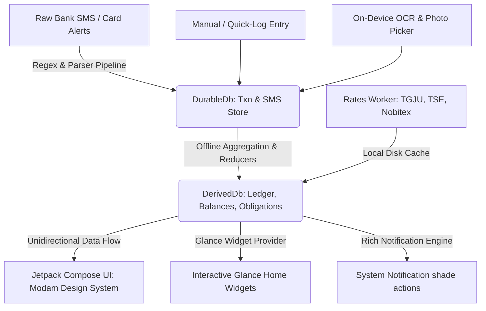
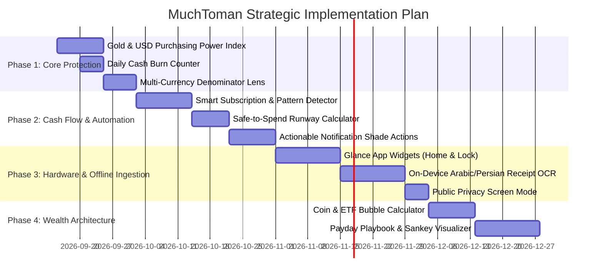

# MuchToman Feature Implementation & Architecture Research

This research document provides production-grade architectural blueprints, mathematical formulations, database schemas, and UX specifications for all 12 proposed feature categories in **MuchToman**. 

MuchToman is a **local-first, privacy-preserving, zero-telemetry Android personal finance tracker** optimized for the high-inflation Iranian economic environment. Every architectural pattern herein adheres to:
1. **100% On-Device Processing:** Zero reliance on third-party cloud analytics, remote storage, or backend processing.
2. **Jalali / Persian First:** Native Jalali date calculations, Persian numerals (`۰-۹`), right-to-left layout symmetry, and Modam typography.
3. **Reactive Jetpack Compose & Clean MVI/MVVM:** State-driven rendering, immutable state projections, and transactional Room persistence.

---



---

## 1. Asset Preservation & Real Inflation Tracking

### 1.1 Gold Index & Purchasing Power
* **Objective:** Counteract nominal money illusion by presenting historical net worth denominated in equivalent physical gold (18k grams) or hard currency.
* **Mathematical Model:**
  Given nominal net worth at historical snapshot $t$ denoted as $W_N(t)$ (in IRR) and the gold rate $P_{gold}(t)$ (in IRR/gram of 18k gold):
  $$W_{real}(t) = \frac{W_N(t)}{P_{gold}(t)}$$
  For rolling inflation drag:
  $$\Delta W_{\%} = \left( \frac{W_{real}(t_1) - W_{real}(t_0)}{W_{real}(t_0)} \right) \times 100$$
* **Room Schema & Architecture:**
  Query historical rates from `DerivedDb`'s `rates_cache` table joined against `daily_snapshots`.
  ```kotlin
  data class PurchasingPowerPoint(
      val day: Long,
      val nominalToman: Long,
      val goldGrams18k: Double,
      val usdtEquivalent: Double,
  )
  ```
* **Compose UI Implementation:**
  Dual-axis scrubbable chart using `androidx.compose.foundation.Canvas`. The left Y-axis renders Toman in Persian compact notation (`faCompact`), while the right Y-axis renders gold grams (`faNumber(grams, 2) + " گرم طلا"`).

### 1.2 Asset Allocation Targets & Rebalancing Alerts
* **Objective:** Maintain disciplined portfolio allocation across core asset classes (Gold, Equities/Bourse, Crypto/Tether, Cash, Fixed-Income).
* **Drift & Order Recommendation Algorithm:**
  Let target weight vector be $\mathbf{w}^* = [w_1^*, \dots, w_k^*]$ where $\sum w_i^* = 1$. Let current valuations be $V_i(t)$ with total portfolio value $V_{total} = \sum V_i(t)$.
  Current weights: $w_i(t) = \frac{V_i(t)}{V_{total}}$.
  Absolute drift: $\delta_i = w_i(t) - w_i^*$.
  Rebalancing action (in Toman):
  $$\Delta V_i = (w_i^* \times V_{total}) - V_i(t)$$
  If $|\delta_i| > \theta_{threshold}$ (default 5%), surface a rebalancing alert: *"طلا ۴٪ بیش از وزن هدف است؛ پیشنهاد جابجایی X تومان به صندوق درآمد ثابت"*.

### 1.3 Custom Base Index & Real vs. Nominal Growth
* **Baseline Selectors:** Allow toggling baseline between:
  1. `18K_GOLD_GRAM` (Tala 18 Ayar)
  2. `EMAMI_COIN` (Sekeh Tamam Emami)
  3. `USD_TETHER` (Nobitex/Tehran Open Market)
  4. `CBI_CPI` (Official Central Bank Consumer Price Index quarterly curve)
* **Fisher Equation for Real Returns:**
  $$1 + R_{real} = \frac{1 + R_{nominal}}{1 + I_{annual}}$$
  $$R_{real} \approx R_{nominal} - I_{annual}$$

---

## 2. Cash Flow & Predictive Intelligence

### 2.1 Month-End Cash Balance Forecasting & Safe-to-Spend
* **Objective:** Answer the fundamental end-of-month question: *"How much can I spend today without risking an overdraft on scheduled commitments?"*
* **Predictive Formula:**
  $$\text{SafeToSpend} = C_{liquid} - \sum_{i \in \text{UnpaidObligations}} O_i - \sum_{j \in \text{ExpectedBills}} B_j - R_{reserved}$$
  $$\text{DailySafeAllowance} = \frac{\text{SafeToSpend}}{\max(1, \text{DaysRemainingInPayPeriod})}$$
  Where:
  - $C_{liquid}$: Total liquid checking and wallet balances.
  - $O_i$: Unpaid installments scheduled before next paycheck.
  - $B_j$: Detected recurring bills (rent, utilities, subscriptions).
  - $R_{reserved}$: Explicit budget reservations.

### 2.2 Smart Recurring Subscription & Bill Detection Engine
* **Heuristic Clustering Algorithm:**
  1. Filter all outbound ledger entries ($direction = \text{"out"}$).
  2. Group by normalized merchant (`merchantNorm`) or IBAN destination hash.
  3. Calculate inter-arrival intervals $\Delta t_k = t_k - t_{k-1}$ in days.
  4. Recurring criteria:
     - Count $N \ge 2$.
     - Interval regularity: $\text{StdDev}(\Delta t) \le 3.5$ days around modal period (e.g. 29–31 days for monthly bills).
     - Amount variance coefficient: $CV = \frac{\sigma(A)}{\mu(A)} \le 0.12$ (or identical amount for fixed rent/installments).
* **Room Entity:**
  ```kotlin
  @Entity(tableName = "recurring_pattern")
  data class RecurringPattern(
      @PrimaryKey val id: String,
      val merchantNorm: String,
      val expectedDayOfJalaliMonth: Int,
      val medianAmountRial: Long,
      val cadence: String, // "monthly", "quarterly", "annual"
      val autoDetected: Boolean = true,
      val confirmedByUser: Boolean = false,
      val lastSeenAt: Long,
  )
  ```

---

## 3. Redesigned Quick-Log & Data Ingestion

### 3.1 Android Glance Home Screen Quick-Access Widget
* **Technology:** Jetpack Glance (`androidx.glance:glance-appwidget:1.1.0`).
* **Capabilities:**
  - **1-Tap Cash Entry:** Uses Glance `ActionCallback` launching a transparent floating quick-entry dialog without full app startup latency.
  - **Live Gold & Tether Ticker:** Directly reads cached rates from `rates_cache` updated via background `PriceWorker`.
  - **Countdown to Next Installment:** Displays days left and amount for the nearest due `ObligationPayment`.
* **RTL & Widget Design:** Native Modam font embedded in RemoteViews XML layout fallback, high-contrast dark palette (`Color(0xFF14120E)` surface with `0xFFD4A373` gold accents).

### 3.2 On-Device Receipt OCR & Local Attachment
* **Camera / Document Ingestion:**
  Use AndroidX Photo Picker via `ActivityResultContracts.PickVisualMedia()`:
  - Zero storage permissions requested (`READ_MEDIA_IMAGES` / `READ_EXTERNAL_STORAGE` not needed).
  - Copies selected photo into app-private internal storage: `context.filesDir.resolve("receipts/${txnRef}.webp")`.
* **On-Device OCR Engine:**
  - **Google ML Kit Text Recognition for Arabic/Persian:** `com.google.mlkit:text-recognition-arabic:16.0.0-beta1`.
  - Runs fully on-device via local neural models without remote data egress.
  - **Regex Tokenizer for Iranian POS Slips:**
    ```kotlin
    val POS_AMOUNT_REGEX = Regex("""(?:مبلغ|ریال|تومان|مبلغ تراکنش)[^\d]*([\d,،]{4,12})""")
    val POS_REF_REGEX = Regex("""(?:پیگیری|شماره ارجاع|مرجع|rrn|trace)[^\d]*([0-9]{6,12})""", RegexOption.IGNORE_CASE)
    val POS_CARD_REGEX = Regex("""([0-9]{4}[-\s*]+[0-9*]{4}[-\s*]+[0-9*]{4}[-\s*]+[0-9]{4})""")
    ```

### 3.3 Public Privacy Mode
* **Mechanism:** Instant global state `var privacyModeEnabled by mutableStateOf(false)`.
* **Activation Gestures:**
  - Two-finger double-tap on screen.
  - Accelerometer flip (face-down triggers privacy, face-up retains masked view).
* **Compose Modifier:**
  ```kotlin
  fun Modifier.privacyBlur(enabled: Boolean): Modifier = if (enabled) {
      this.blur(radius = 16.dp, edgeTreatment = BlurredEdgeTreatment.Rectangle)
          .semantics { contentDescription = "مخفی شده در حالت محرمانه" }
  } else this
  ```

---

## 4. Currency, Crypto & Hedging Hub

### 4.1 Multi-Currency Lens Architecture
* **Implementation:** Top bar persistent segmented pill: `[تومان | تتر | طلا ۱۸ | سکه امامی]`.
* **Reactive Transformation:**
  Rather than converting prices at the DB layer, the ViewModel exposes an active `CurrencyDenominator` state flow:
  ```kotlin
  enum class CurrencyDenominator(val labelFa: String, val symbol: String) {
      TOMAN("تومان", "T"),
      USD_TETHER("تتر", "USDT"),
      GOLD_18K("گرم طلا", "g18"),
      EMAMI("سکه امامی", "سکه");
  }
  ```
  All UI cards transform their formatted strings through a pure functional formatter:
  `fun formatInBase(amountRial: Long, base: CurrencyDenominator, rates: EffectiveRates): String`.

### 4.2 Gold Coin & ETF Bubble Calculator
* **Financial Formulas:**
  1. **Intrinsic Value of Bahar Azadi / Emami Coin:**
     Coin specifications (Bank Markazi Iran): Gross weight = $8.133$ grams, Purity = $900/1000$ (21.6 Karat). Fine gold content = $8.133 \times 0.900 = 7.3197$ grams.
     $$\text{IntrinsicRial} = \left(\frac{\text{Fine Weight (g)}}{31.1035} \times P_{XAU\_USD} \times \text{USD\_IRR}\right) \times 1.09$$
     *(Where $1.09$ accounts for standard 9% minting and regulatory fee allowances).*
  2. **Market Bubble Percentage:**
     $$\text{Bubble}_{\%} = \left(\frac{P_{market} - \text{IntrinsicRial}}{P_{market}}\right) \times 100$$
  3. **Gold Mutual Funds (Tala, Ayar, Zarrin, Kahroba):**
     $$\text{ETF Premium}_{\%} = \left(\frac{\text{Closing Price} - \text{NAV}}{\text{NAV}}\right) \times 100$$
     Identifies whether physical coin premiums exceed fund premiums, signaling an optimal switch window.

---

## 5. Zero-Friction UX & Actionable Interactions

### 5.1 Interactive Notification Shade Actions
* **Architecture:**
  ```mermaid
  sequenceDiagram
      autonumber
      participant Tel as Telephony SMS Broadcast
      participant Receiver as SmsReceiver
      participant Notif as Android NotificationManager
      participant ActionReceiver as QuickActionReceiver
      participant DB as DurableDb

      Tel->>Receiver: Incoming Bank SMS (e.g. Mellat 500k)
      Receiver->>DB: Parse & Store Txn (inferred category)
      Receiver->>Notif: Post Notification with Category Action Buttons
      Note over Notif: [🛒 سوپرمارکت] [🍔 غذا] [🚕 تاکسی] [کارت‌به‌کارت]
      User->>ActionReceiver: Taps [🍔 غذا] button
      ActionReceiver->>DB: Update Txn Category + Record Rule
      ActionReceiver->>Notif: Dismiss / Update Notification to "ذخیره شد"
  ```
* **Implementation Details:**
  - `PendingIntent.getBroadcast()` with action `ACTION_QUICK_CATEGORIZE`.
  - Notification channels: `muchtoman_transactions` (Importance HIGH).
  - Inline action buttons allow one-tap correction without context-switching away from current apps.

### 5.2 Currency-Pegged Savings Goals
* **Problem:** In an economy where prices double annually, a fixed 50,000,000 Toman savings goal loses half its purchasing power before completion.
* **Solution:** Store goal target in pegged base units:
  ```kotlin
  @Entity(tableName = "pegged_goal")
  data class PeggedGoal(
      @PrimaryKey val id: String,
      val title: String,
      val targetAmountInPeg: Double, // e.g. 15.0 grams of gold or 1000.0 USDT
      val pegType: String, // "GOLD_18K", "USDT", "EMAMI"
      val savedRial: Long,
      val deadlineDay: Long,
  )
  ```
  Daily progress dynamically scales with live exchange rates:
  $$\text{RequiredTomanToday} = \text{TargetPeg} \times \text{SpotRateToday}$$
  $$\text{Progress}_{\%} = \frac{\text{SavedToman}}{\text{RequiredTomanToday}} \times 100$$

---

## 6. Behavioral Economics & Gamification

### 6.1 Life-Energy Cost (Labor Hours per Purchase)
* **Concept:** Grounded in Vicki Robin's *Your Money or Your Life*. Converts consumer expenses into the direct unit of life exchanged: hours of labor.
* **Calculation:**
  Given net monthly wage $W_{net}$ and monthly working hours $H$ (default 176 hours in Iranian labor law):
  $$\text{HourlyRate} = \frac{W_{net}}{H}$$
  $$\text{LifeEnergyHours} = \frac{\text{PurchaseToman}}{\text{HourlyRate}}$$
* **Display in Transaction Screen:**
  A discreet pill beneath the amount:
  `⏳ معادل ۳ ساعت و ۴۵ دقیقه از کار و زمان شما`

### 6.2 Solar Hijri Financial Wrapped (کارنامه مالی سال)
* **Retrospective Engine:** Runs locally in Esfand/Farvardin summarizing the Solar Hijri year:
  - Top spending Jalali month.
  - Biggest counterparty recipients (P2P card transfers).
  - Total bank fees and SMS subscription deductions paid to banking networks.
  - **Counterfactual Opportunity Cost:**
    $$\text{LostWealth} = \sum_{k} \left( \text{DiscretionaryPurchase}_k \times \frac{P_{gold}(t_{now})}{P_{gold}(t_k)} \right) - \sum \text{DiscretionaryPurchase}_k$$
    *"اگر مخارج خرد غیرضروری ماهانه به صندوق طلا اختصاص یافته بود، ارزش امروز آن X تومان بود."*

---

## 7. Debt Management & Credit Architecture

### 7.1 Debt Erosion Under High Inflation
* **Financial Concept:** Fixed-rate debt with negative real interest rates transfers wealth from the lender to the borrower.
* **Visual Representation:**
  For a fixed 4,000,000 Toman monthly loan installment:
  - Month 1: 4,000,000 Toman = 1.00g Gold (10% of monthly income).
  - Month 24: 4,000,000 Toman = 0.42g Gold (4.2% of monthly income).
* **Graphing:** Plotting real value decay over the loan term provides immense psychological relief and reinforces long-term asset-holding behavior.

### 7.2 BNPL Aggregator & Sayyad Check Tracker
* **Supported BNPL Providers:** SnappPay (اسنپ‌پی), DigiPay (دیجی‌پی), Tapsi (تپسی), Tara (تارا).
* **Sayyad Check Room Architecture:**
  ```kotlin
  @Entity(tableName = "sayyad_check")
  data class SayyadCheck(
      @PrimaryKey val id: String,
      val sayyadId: String, // 16 digits
      val direction: String, // "issued" or "received"
      val bank: String,
      val amountRial: Long,
      val dueDate: Long,
      val counterparty: String,
      val cleared: Boolean = false,
      val alertDaysBefore: Int = 3,
  )
  ```
  Automatic reconciliation: When a debit SMS arrives on `dueDate` matching `amountRial` from the issuer's bank, automatically mark check as cleared.

---

## 8. Micro-Asset Optimization & Automation

### 8.1 Virtual Round-Up Micro-Savings
* **Mechanics:**
  For every expense transaction, round up to the nearest configurable interval (e.g. 50,000 or 100,000 Toman):
  $$\text{RoundUp}(A, \Delta) = \lceil A / \Delta \rceil \times \Delta - A$$
  *Example:* A 64,000 Toman coffee rounds up to 100,000 Toman $\implies$ 36,000 Toman virtual micro-saving.
* **Trigger Threshold:** When accrued virtual round-up reaches 500,000 Toman (minimum investment threshold for Iranian Gold Mutual Funds on TSE), trigger a nudge:
  *"قلک خرد شما به ۵۰۰,۰۰۰ تومان رسید! اکنون می‌توانید ۱ واحد صندوق طلا (عیار/طلا) خریداری کنید."*

### 8.2 48-Hour Wishlist & Cooling-Off Queue
* Prevents dopamine-driven impulse purchases.
* User logs an item into the Wishlist instead of purchasing immediately.
* A countdown timer starts. At 48 hours, a notification checks: *"آیا پس از گذشت ۲ روز هنوز به خرید این کالا نیاز دارید؟"*
* Telemetry-free statistical tracker shows: *"شما در این ماه از خرید غیرضروری ۳,۸۰۰,۰۰۰ تومان منصرف شدید."*

---

## 9. Inflation Defense & Purchasing Power Engines

### 9.1 Daily Cash Burn Rate Counter
* **Core Insight:** Holding uninvested Rial balances incurs an invisible, guaranteed daily loss due to compounding inflation.
* **Formula:**
  Given total uninvested checking cash $C_{cash}$ and estimated annual inflation $I_{CPI} \approx 45\%$:
  $$\text{DailyErosion} = C_{cash} \times \left( (1 + I_{CPI})^{\frac{1}{365}} - 1 \right) \approx C_{cash} \times \frac{0.45}{365}$$
  For 40,000,000 Toman cash: $\text{DailyLoss} \approx 49,300$ Toman/day.
* **Banner Display:**
  `🔥 کاهش ارزش روزانه نقدینگی شما: ۴۹,۰۰۰ تومان در روز`

### 9.2 Failed POS Transaction Watchdog (مغایرت شتابی)
* **Problem:** POS machines frequently deduct funds on connection timeouts ("تراکنش ناموفق") with a promise of refund within 72 hours. Users routinely forget to check if the reversal arrived.
* **Watchdog Heuristic:**
  1. Detect SMS containing: `"ناموفق"`, `"مغایرت"`, or `"برگشت وجه"`.
  2. If debit occurred, create a pending 72-hour `ReversalWatchdog` entry.
  3. Scan incoming deposit SMS for identical amount and card mask.
  4. If after 72 hours no credit matches, dispatch high-priority notification:
     *"مبلغ ۲۵۰,۰۰۰ تومان کسر شده از کارت سامان پس از ۷۲ ساعت بازنگشته است؛ با بانک تماس بگیرید."*

### 9.3 Iranian Bank Card BIN Intelligence
* Store a lightweight, static, compiled Kotlin map of all 6-digit Bank Identification Numbers:
  ```kotlin
  val BANK_BINS: Map<String, BankInfo> = mapOf(
      "603799" to BankInfo(Bank.MELLI, "ملی"),
      "610433" to BankInfo(Bank.MELLAT, "ملت"),
      "621986" to BankInfo(Bank.SAMAN, "سامان"),
      "502229" to BankInfo(Bank.PASARGAD, "پاسارگاد"),
      "639346" to BankInfo(Bank.SINA, "سینا"),
      "504706" to BankInfo(Bank.SHAHRE, "شهر"),
      "627412" to BankInfo(Bank.EN, "اقتصاد نوین"),
      "589210" to BankInfo(Bank.SEPAH, "سپه"),
      "603770" to BankInfo(Bank.KESHAVARZI, "کشاورزی"),
      "628023" to BankInfo(Bank.MASKAN, "مسکن"),
      "627760" to BankInfo(Bank.POST, "پست بانک"),
      "502908" to BankInfo(Bank.TOSEETAAVON, "توسعه تعاون"),
      "627353" to BankInfo(Bank.TEJARAT, "تجارت"),
      "603769" to BankInfo(Bank.SADERAT, "صادرات"),
      "627381" to BankInfo(Bank.ANSAR, "انصار"),
      "505416" to BankInfo(Bank.GARDESHGARI, "گردشگری"),
      "639607" to BankInfo(Bank.SARMAYEH, "سرمایه"),
      "636214" to BankInfo(Bank.AYANDEH, "آینده"),
      "505785" to BankInfo(Bank.IRANZAMIN, "ایران زمین"),
      "636949" to BankInfo(Bank.HEKMAT, "حکمت"),
      "505801" to BankInfo(Bank.KOWSAR, "کوثر"),
      "627961" to BankInfo(Bank.SANATMADAN, "صنعت و معدن"),
      "606373" to BankInfo(Bank.MEHRIRAN, "مهر ایران"),
      "504172" to BankInfo(Bank.RESALAT, "رسالت"),
  )
  ```

---

## 10. Social Contracts & Physical Asset Ledgers

### 10.1 P2P Debt & Loan Ledger (قرض‌الحسنه / بستانکاران و بدهکاران)
* Track personal loans with friends, family, and colleagues.
* Counterparty entity linked to contacts or manual names.
* Auto-matching: When a P2P transfer arrives from a known counterparty card or Shaba, prompt to settle open credit balance.

### 10.2 Rental Housing Deposit (رهن کامل / ودیعه مسکن)
* **The Dilemma:** Residential deposits are often the user's largest single liquid asset, but return 0% nominal interest while real value plummets over a 12-month lease.
* **Tracking Formula:**
  $$\text{Erosion}_{\%} = \left( \frac{\text{SpotGoldRateToday}}{\text{SpotGoldRateLeaseStart}} - 1 \right) \times 100$$
  Equips the tenant with objective data during annual lease renewal and rent adjustment negotiations.

### 10.3 Sankey Flow Chart Visualizer
* **Custom Compose Canvas Renderer:**
  Maps inflows $\to$ allocations $\to$ expense categories $\to$ investments.
  Uses cubic Bezier curves (`Path.cubicTo`) with alpha gradients connecting node blocks, fully rendered on-device with zero webview overhead.

---

## 11. Capital Micro-Allocation (Sub-1M Toman Strategies)

### 11.1 Low-Barrier Financial Instruments Guide
When small cash balances ($< 1,000,000$ Toman) linger in checking accounts:
1. **Exchange-Traded Gold Funds (ETF):**
   - Symbols: `عیار` (Ayar), `طلا` (Tala), `کهربا` (Kahroba), `زرین` (Zarrin).
   - Entry ticket: 500,000 Toman.
   - Brokerage commission: $\approx 0.15\%$ (drastically lower than physical gold jeweler spreads of 7–15%).
2. **Fixed-Income Funds (صندوق درآمد ثابت):**
   - Daily compounding returns ($26\% - 31\%$ annualized).
   - Zero redemption penalty, T+1 settlement.
3. **Weekly DCA Strategy:**
   Calculates the mathematical advantage of systematic weekly accumulation over lump-sum market timing under high volatility regimes.

### 11.2 Central Bank Tax & Velocity Monitoring
* Iranian tax regulations monitor account transaction velocity (e.g. 200 inbound transactions/month totaling over specific thresholds flagged as commercial/taxable).
* MuchToman provides an offline counter of monthly inbound transactions to alert users before triggering automated commercial classification holds.

---

## 12. Smart Frugality & Automated Month-Start Playbooks

### 12.1 The Payday Playbook (تقسیم حقوق ۳۰ ثانیه‌ای)
* **Trigger:** An incoming deposit matching `Salary` pattern ($direction = \text{"in"}$ and amount exceeding monthly baseline).
* **Automated Capital Allocation Prompt:**
  ```
  ┌──────────────────────────────────────────────────────────┐
  │ حقوق ماه جاری دریافت شد: ۵۰,۰۰۰,۰۰۰ تومان                │
  ├──────────────────────────────────────────────────────────┤
  │ پیشنهاد تخصیص خودکار:                                     │
  │ • مخارج جاری ماه (۴۰٪): ۲۰,۰۰۰,۰۰۰ تومان                 │
  │ • اقساط و بدهی‌ها (۳۰٪): ۱۵,۰۰۰,۰۰۰ تومان (۳ قسط فعال)    │
  │ • سپر تورمی (صندوق طلا/تتر) (۲۰٪): ۱۰,۰۰۰,۰۰۰ تومان      │
  │ • قلک اضطراری درآمد ثابت (۱۰٪): ۵,۰۰۰,۰۰۰ تومان          │
  └──────────────────────────────────────────────────────────┘
  ```

### 12.2 Financial Runway Counter
* Measures resilience in months:
  $$\text{FinancialRunway (Months)} = \frac{\text{Total Liquid Holdings + Gold + Readily Marketable ETFs}}{\text{Median Monthly Burn Rate over Past 6 Months}}$$
  Visualized as a shield indicator on the Home Overview screen.

---

## Implementation Roadmap & Milestone Staging



---

## Primary Technical References & Standards

1. **Android Jetpack Glance:** Google Developers Official Guide, `androidx.glance:glance-appwidget` documentation for Compose-driven remote widget layouts.
2. **Google ML Kit Text Recognition:** `com.google.mlkit:text-recognition-arabic` standalone on-device vision bundle.
3. **Android Photo Picker API:** Android Developer Guide on Privacy-Preserving Media Access via `ActivityResultContracts.PickVisualMedia`.
4. **Central Bank of the Islamic Republic of Iran (CBI):** Specifications for SHETAB Interbank Switch, Sheba/IBAN formats (ISO 13616 standard), and Sayyad Check verification guidelines.
5. **Tehran Gold & Jewelry Union (TGJU) & Tehran Stock Exchange (TSE):** Calculation standards for gold purity (Mesghal to Gram conversions) and Mutual Fund NAV pricing rules.
